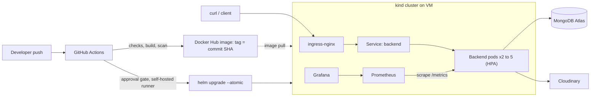

# Job Portal: DevOps Project

| | |
|---|---|
| **Student** | Syeda Noorain |
| **Student ID** | 23bcs10221 |
| **Project** | Job Portal (React frontend, Express and MongoDB backend) |
| **Repository** | https://github.com/Noorain464/job_portal |
| **Baseline commit** | `2a8f3f89d6084b9439f6e36b4d01e986ac197984` ([permanent link](https://github.com/Noorain464/job_portal/commit/2a8f3f89d6084b9439f6e36b4d01e986ac197984)), also tagged `baseline-v0` |
| **Final commit** | `<FINAL_COMMIT_HASH>` |
| **Pull request** | `<PR_LINK>` |

## The application

A job portal where students register, log in and browse jobs, and recruiters manage companies and postings.
The **frontend** (React) is hosted on Vercel: https://job-portal-mu-blush.vercel.app
The **backend** (Express, MongoDB Atlas, Cloudinary for profile photos) was originally hosted on Render: https://job-portal-v2ng.onrender.com

## What existed at the baseline

Only hosting: frontend on Vercel, backend on Render. No Dockerfile, no CI/CD, no Kubernetes, no health endpoints, no metrics, no tests. See [`BASELINE.md`](BASELINE.md).

## What this PR adds

The backend now has a complete delivery and runtime setup on Kubernetes (kind, running on a local VM).

| Area | Addition |
|---|---|
| App | `/healthz`, `/readyz` (checks MongoDB), `/version` (git SHA), `/metrics` (Prometheus histogram) |
| Container | Multi-stage Dockerfile, non-root user, npm removed from the runtime image, commit SHA baked in |
| Kubernetes | Helm chart: Deployment (2 replicas, rolling update, startup/liveness/readiness probes, resource limits), Service, Ingress, HPA, ConfigMap, NetworkPolicy |
| CI | GitHub Actions: secret scan, install, syntax check, dependency audit, Helm lint, arm64 image build, image vulnerability scan, push to Docker Hub tagged with the commit SHA |
| CD | Deploy job on a self-hosted runner behind a manual approval gate, `helm upgrade --atomic`, then a smoke test that checks the running `/version` equals the deployed commit |
| Observability | Prometheus and Grafana (kube-prometheus-stack), ServiceMonitor, dashboard (`monitoring/backend-dashboard.json`), three alert rules with documented response actions |
| Security | Secrets created on the cluster (never in git), non-root and dropped capabilities, NetworkPolicy tested for enforcement, Gitleaks, `npm audit`, Trivy, rotated JWT signing key |
| Evidence | `docs/evidence/` (fault demo, user journey, NetworkPolicy test), `scripts/user-journey.sh` |

## Architecture



**Request path:** client → ingress-nginx (routes by `Host` header) → `backend` Service → one of the ready pods → MongoDB Atlas / Cloudinary.

**Failure boundaries:**
- A pod that fails `/readyz` is removed from the Service without being restarted, for example when the database is unreachable.
- A pod that fails `/healthz` is restarted.
- A bad release is contained by `maxUnavailable: 0`: new pods must pass readiness before old ones are removed.
- MongoDB and Cloudinary are external, so the cluster holds no persistent state and the backend is a plain Deployment, not a StatefulSet.

## Delivery flow (commit to running pod)

1. Push to `main` or `devops-improvements` (pull requests run checks and build only; they never push or deploy).
2. `checks`: Gitleaks, `npm ci`, `node --check`, `npm audit` (high and above), `helm lint`.
3. `build`: arm64 image built, scanned by Trivy (fails on fixable CRITICAL findings), pushed as `noorain464/job-portal-backend:<7-char SHA>`.
4. `deploy` waits for approval on the `k8s-vm-production` environment, then runs on the self-hosted runner:
   `helm upgrade --install job-portal helm/job-portal --set backend.image.tag=<SHA> --atomic`.
5. Smoke test: polls `/version` through the Ingress until it equals the deployed SHA.

**Traceability:** the commit SHA appears in the image tag, the `app.kubernetes.io/version` label, `/version`, and `helm get values`.
**Recovery:** `--atomic` rolls back automatically if pods never become ready; `helm rollback job-portal` rolls back manually.

## Run instructions

### Prerequisites
A Linux host (tested on arm64, Ubuntu on UTM) with at least 20 GB free disk and 4 GB RAM, plus Docker, [kind](https://kind.sigs.k8s.io), `kubectl`, and Helm 3. A MongoDB Atlas database (with the host's public IP allowed) and a Cloudinary account.

### 1. Create the cluster and add-ons
```bash
kind create cluster --config deploy/kind-config.yaml
kubectl apply -f https://kind.sigs.k8s.io/examples/ingress/deploy-ingress-nginx.yaml
kubectl apply -f https://github.com/kubernetes-sigs/metrics-server/releases/latest/download/components.yaml
kubectl -n kube-system patch deploy metrics-server --type=json \
  -p='[{"op":"add","path":"/spec/template/spec/containers/0/args/-","value":"--kubelet-insecure-tls"}]'
```

### 2. Create the backend Secret (one-time, never committed)
```bash
read -rsp "MONGO_URL: " MONGO_URL; echo
read -rsp "CLOUD_NAME: " CLOUD_NAME; echo
read -rsp "API_KEY: " API_KEY; echo
read -rsp "API_SECRET: " API_SECRET; echo
kubectl create secret generic backend-secrets \
  --from-literal=MONGO_URL="$MONGO_URL" --from-literal=SECRET_KEY="$(openssl rand -hex 32)" \
  --from-literal=CLOUD_NAME="$CLOUD_NAME" --from-literal=API_KEY="$API_KEY" --from-literal=API_SECRET="$API_SECRET"
unset MONGO_URL CLOUD_NAME API_KEY API_SECRET
```

### 3. Install monitoring (before the app, because the chart uses its CRDs)
```bash
helm repo add prometheus-community https://prometheus-community.github.io/helm-charts
helm repo update
helm upgrade --install monitoring prometheus-community/kube-prometheus-stack \
  -n monitoring --create-namespace -f deploy/monitoring-values.yaml --wait --timeout 10m
```

### 4. Deploy the app

**Through the pipeline (normal path):**
1. Add repository secrets `DOCKERHUB_USERNAME` and `DOCKERHUB_TOKEN` (a Docker Hub access token with Read and Write).
2. Create the GitHub environment `k8s-vm-production` with yourself as a required reviewer.
3. Register a self-hosted runner on the VM (Settings → Actions → Runners) with the label `job-portal-vm`, and install it as a service.
4. Push a commit and approve the `deploy` job.

**Manually (first install or debugging):**
```bash
helm upgrade --install job-portal helm/job-portal --set backend.image.tag=<7-char-sha> --atomic
```

### 5. Verify
```bash
kubectl get pods,svc,ingress,hpa,networkpolicy
curl -H "Host: api.job-portal.local" http://localhost/version
curl -H "Host: api.job-portal.local" http://localhost/readyz
bash scripts/user-journey.sh        # register, login, authenticated read, auth rejection
```
The ingress hostname is configurable with `--set backend.ingress.host=<host>`.

### 6. Dashboards
```bash
kubectl -n monitoring port-forward svc/monitoring-grafana 3000:80
kubectl -n monitoring get secret monitoring-grafana -o jsonpath='{.data.admin-password}' | base64 -d; echo
```
Open `http://localhost:3000`, log in as `admin`, then import `monitoring/backend-dashboard.json`. If the VM is remote, tunnel first: `ssh -L 3000:localhost:3000 <vm>`.

## What "healthy" means

| Signal | Target | Alert (`helm/job-portal/templates/prometheusrule.yaml`) |
|---|---|---|
| Availability | at most 5% of user requests return 5xx (probe and scrape routes excluded) | `BackendHighErrorRate`, critical |
| Latency | p95 below 1 s | `BackendHighLatency`, warning |
| Reachability | at least one pod scrapeable | `BackendDown`, critical |

Each alert has an `action` annotation describing the first response. Recovery is verified by `/readyz`, the replica count on the dashboard, and the smoke test.

## Evidence (`docs/evidence/`)

| File | What it shows |
|---|---|
| `fault-demo.txt` | 488 requests during a deliberate bad release (non-existent image tag): all returned HTTP 200, including all 175 inside the fault window |
| `fault-demo-events.txt` | Timeline: deploy of bad tag, old pods still serving, rollback, same version restored |
| `fault-demo-history.txt` | Helm revision history showing the bad release and the rollback |
| `user-journey.txt` | register (201), login (200), authenticated read (200), unauthenticated read (401), with `/version` before and after |
| `networkpolicy-test.txt` | Pod-to-pod access blocked after enabling the policy; ingress and Prometheus still work |
| `monitoring/backend-dashboard.json` | Grafana dashboard: request rate, error ratio, p95 latency, available replicas |

Note: log timestamps are UTC; Grafana screenshots are in IST (UTC+5:30). The Cloudinary account name is redacted in `user-journey.txt`.

## Decisions and trade-offs

- **Deployment, not StatefulSet:** the backend is stateless; its data lives in Atlas.
- **kind on a VM, not a cloud cluster:** free, reproducible, and acceptable under the project rules. Cost: single node, so no node-level redundancy.
- **Rolling update, not blue-green or canary:** two replicas and low traffic make rolling updates with `maxUnavailable: 0` sufficient. With real traffic and risky releases, I would add canary with traffic splitting.
- **GitHub Actions with a self-hosted runner, not Argo CD:** the cluster is on a private network with no inbound access, so the runner's outbound-only connection suits it. Push-based deploy means git and cluster can drift if someone runs `helm` by hand; the pipeline is the intended single path in.
- **Manual approval gate:** the deploy job targets a machine I own, so a human approves each release. The self-hosted runner only runs jobs for pushes, never for pull requests.
- **Docker Hub, public image:** the image contains no secrets (they come from a Kubernetes Secret at runtime), so the cluster pulls without credentials.
- **Probes split deliberately:** liveness ignores the database (a database outage must not restart pods in a loop); readiness checks it.
- **Metrics label `route` falls back to `"unmatched"`** to avoid unbounded label cardinality from arbitrary URLs.

## Known limitations

- **Frontend not switched to the cluster.** The Vercel frontend still calls the Render backend. The cluster is only reachable from the VM, and a browser on Vercel needs a public HTTPS URL (a tunnel or domain would be needed). The cluster deployment is demonstrated with `curl` through the Ingress.
- **No automated tests.** CI runs a syntax check, dependency audit and chart lint, but the project has no unit tests.
- **Bug found in the original app (not fixed, to keep this PR to DevOps changes):** `POST /api/user/register` throws when no profile photo is sent, and the `catch` block logs but never responds, so the request hangs. Found while writing the user-journey test. Proposed fix: return 400 when `req.file` is missing and send a 500 response from every `catch`. Because the request never completes, it produces no 5xx metric, so the error-rate alert would not see it.
- **Alertmanager is disabled** to save memory: alerts are visible in Prometheus and Grafana but nothing sends a notification.
- **Prometheus data is not persistent** (`emptyDir`); it is lost if the pod restarts.
- **No log aggregation or tracing.** Logs are read with `kubectl logs`.
- **Secrets are base64, not encrypted at rest.** Anyone with `get secret` permission can read them. Next steps: etcd encryption or Sealed Secrets.
- **NetworkPolicy restricts ingress only.** Egress is open because the backend must reach Atlas and Cloudinary.
- **No graceful shutdown handler** in the app (`SIGTERM`), so in-flight requests can be cut during a pod replacement.
- **Single-node kind cluster, arm64-only image.** The cluster does not survive some failures of the VM; during the project a full disk and a reboot caused crash loops that I diagnosed and fixed (disk extended to 22 GB, DNS restart).
- **ingress-nginx** is announced for retirement; a production setup would move to another controller or the Gateway API.
- **Test data:** the user-journey script creates users named `devops-test-<timestamp>@example.com` in the database.

## Repository layout

```
backend/                      Express API (+ Dockerfile, health and metrics endpoints)
frontend/                     React app (unchanged)
helm/job-portal/              Helm chart
deploy/                       kind and monitoring configuration
monitoring/                   Grafana dashboard JSON
scripts/user-journey.sh       End-to-end request test
docs/evidence/                Recorded runs and logs
.github/workflows/ci.yml      CI and CD pipeline
BASELINE.md                   Baseline record
```